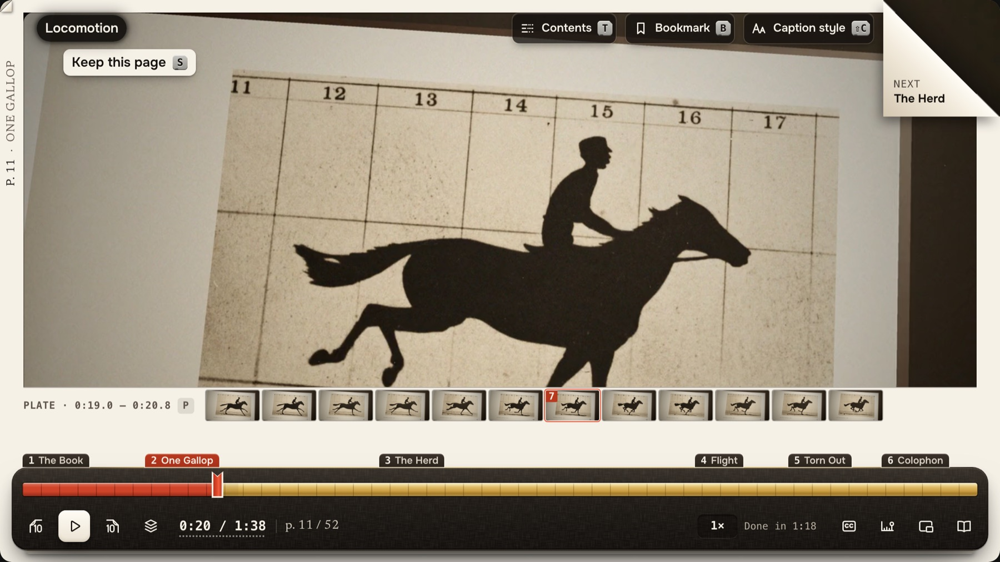
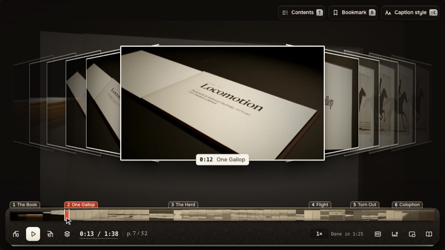
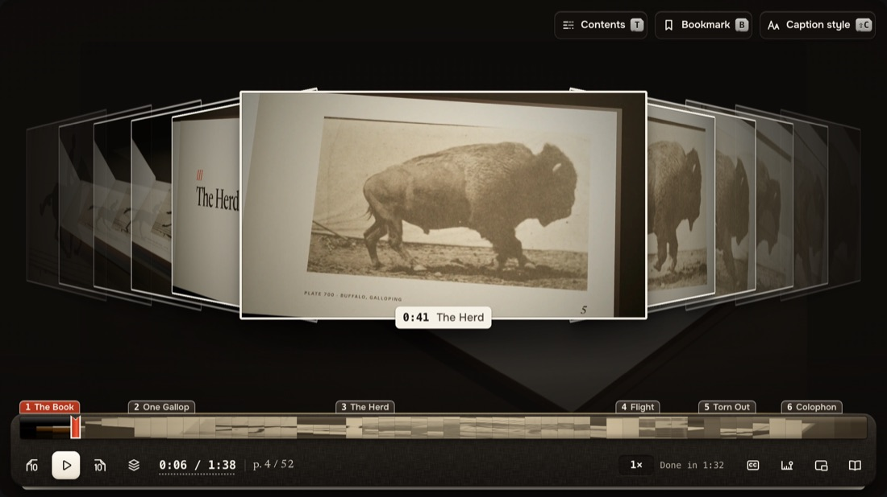
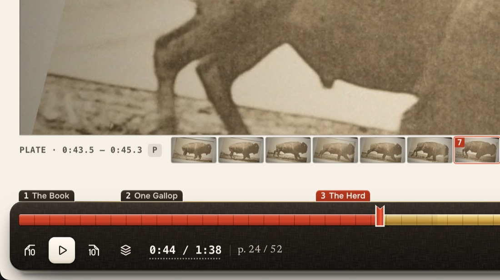
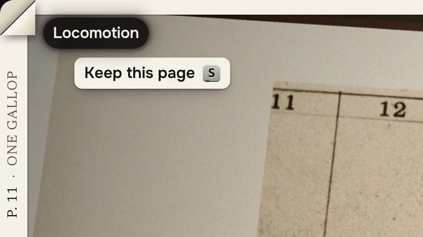
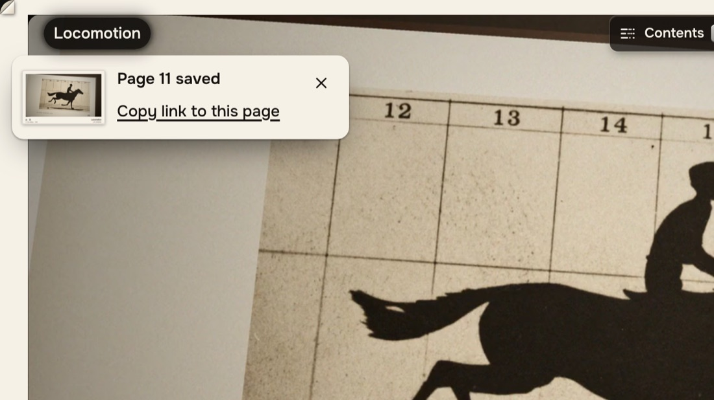
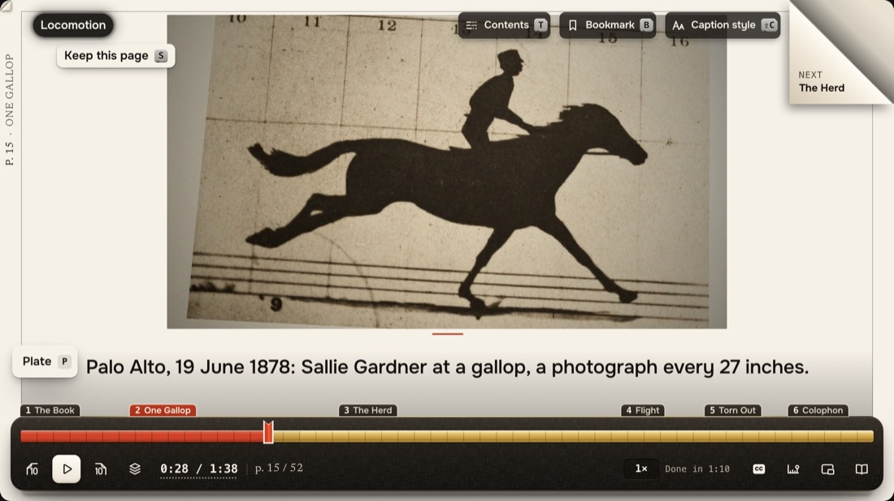
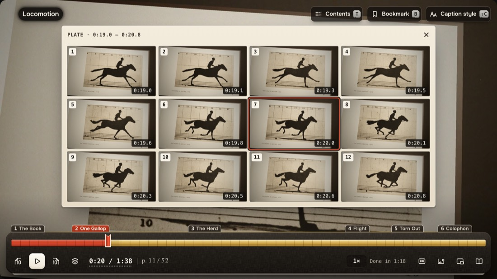
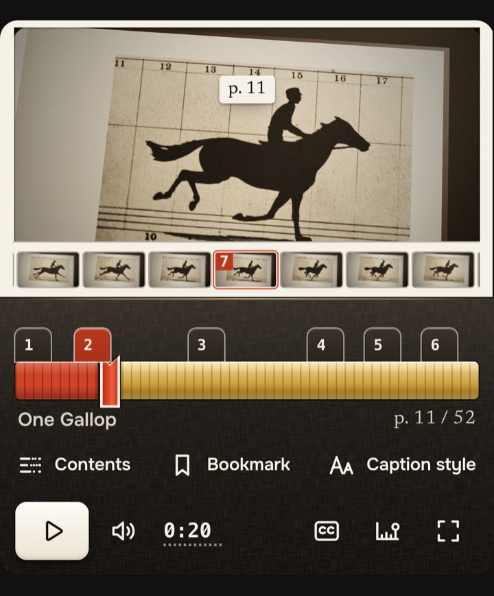

# Flipbook

Flipbook is a skin for [Video.js 10](https://videojs.org) that plays a film like a flipbook. You drag the edge of the book and your hand sets the frame rate.

**Try it at [flipbook.gua.studio](https://flipbook.gua.studio).** The project page is at [gua.studio/work/flipbook](https://gua.studio/work/flipbook).

<a href="https://flipbook.gua.studio"></a>

The seek bar is the book's fore-edge. Drag along it and the pages riffle under your hand, as fast or as slow as you move, and when you let go the film carries on from there.

<picture>
  <source srcset="docs/images/flip.webp" type="image/webp">
  
</picture>

## What it does

Everything else grew out of that one idea.

<table>
  <tr>
    <td width="50%" valign="top">
      <br>
      <b>Flip by hand, chapter by chapter.</b> A drag, a flick, the wheel or a held arrow key moves the film itself, forwards and back. Chapters are tabs cut into the edge, the way a dictionary's letters are.
    </td>
    <td width="50%" valign="top">
      <br>
      <b>Pausing prints the frame.</b> The picture becomes a page with a paper margin and a page number. The twelve frames around the moment sit in a strip in the margin, a sixth of a second apart, and a click on one turns to it.
    </td>
  </tr>
  <tr>
    <td valign="top">
      <br>
      <b>Dog-ear a moment.</b> <kbd>B</kbd> folds the corner of the page down and leaves a ribbon on the edge to come back to.
    </td>
    <td valign="top">
      <br>
      <b>Tear a page out and keep it.</b> <kbd>S</kbd> saves the frame, set as a page, as a picture. It also makes a link that opens the film on that page.
    </td>
  </tr>
  <tr>
    <td valign="top">
      <br>
      <b>Captions as intertitles.</b> The caption style page can set the words in ink on the page under the picture.
    </td>
    <td valign="top">
      <br>
      <b>The plate.</b> <kbd>P</kbd> lays those twelve frames out large, four by three, as Muybridge printed a gallop. It opens only when you ask.
    </td>
  </tr>
  <tr>
    <td valign="top" align="center">
      
    </td>
    <td valign="top">
      <b>One pad under your thumb.</b> On a phone the picture is the film's alone. The tabs, the fore-edge and the keys sit on a pad under it, and a swipe across the picture flips the film.<br><br>
      <b>For everyone.</b> Every control can be reached from the keyboard, text stays readable over the brightest and darkest frames, and with reduced motion turned on the pages stop moving and simply change. The numbers are <a href="#accessibility-and-performance">below</a>.
    </td>
  </tr>
</table>

Under the book there is an ordinary, complete player, with play, seek, volume, captions, speed, quality, fullscreen, picture-in-picture, AirPlay and Cast, a time you can type, resume and the system's media controls.

The film inside is one I made for it, from Eadweard Muybridge's motion photographs of 1878 and 1887.

[How the flip works](docs/how-the-flip-works.md) explains how the film keeps up with a moving hand.

## Use it

### On your own page

`pnpm build:lib` writes a drop-in bundle to `dist-lib/`. It holds `flipbook.js` (an ES module, minified, Video.js 10 included), `flipbook.css`, and a small chunk for each of the book's extras and each of Video.js's translations, with source maps beside them. Copy the folder to your site, then mount a player on your own video.

```html
<link rel="stylesheet" href="/flipbook/flipbook.css">

<div id="player"></div>

<script type="module">
  import { mountFlipbook } from '/flipbook/flipbook.js';

  mountFlipbook(document.querySelector('#player'), {
    title: 'My film',
    poster: '/media/poster.jpg',
    src: '/media/film.mp4',
    chapters: '/media/chapters.vtt',
    captions: '/media/captions.vtt',
    storyboard: '/media/storyboard.vtt',
  });
</script>
```

`title`, `poster` and `src` are required. `chapters` gives the edge its tabs, `captions` is an English captions track, and `storyboard` (a thumbnails VTT) gives the book its pages. All three are optional. A film with no storyboard has no pages to flip, so it gets the whole player with Video.js's own seek bar, and the extras that are made of pages stay off.

The pages are sharper with one full-size still for each storyboard tile. Put them in a `frames/` folder beside the storyboard and list them in `frames/frames.json` as `[{ "time": 0, "src": "f-00.webp" }, …]`. The player asks for that list once. If it is not there, the storyboard's own tiles are used and the request shows as a 404 in the console.

The skin's typeface is Onest. Serve `apps/preview/public/fonts/flipbook/onest-latin.woff2` at `/fonts/flipbook/onest-latin.woff2`, with `newsreader-latin.woff2` beside it for the page numbers, or set `--fb-font` to a stack of your own.

### A film on a stream

`src` also takes a list, tried in order. For a film on Mux, give it the stream and the asset's MP4. No HLS library is loaded. The browser plays the stream where it has HLS of its own (Safari, and Chrome and Edge from 142) and takes the MP4 elsewhere (Firefox). A source that cannot be reached gives way to the next.

```js
const id = 'YOUR_PLAYBACK_ID';

mountFlipbook(document.querySelector('#player'), {
  title: 'My film',
  poster: `https://image.mux.com/${id}/thumbnail.webp`,
  src: [`https://stream.mux.com/${id}.m3u8`, `https://stream.mux.com/${id}/720p.mp4`],
  scrub: '/media/film-720.mp4',
  chapters: '/media/chapters.vtt',
  captions: '/media/captions.vtt',
});
```

`scrub` is what keeps a streamed film a flipbook. A stream has a keyframe every few seconds, so a frame asked of it while paused arrives in 0.3 to 2.5 seconds. `scrub` is a silent copy of the same film that seeks at once. Encode it with a keyframe every second, and 720p is plenty. The hand flips the copy, frame by frame, and the stream takes the picture back on the frame where the hand rests. The copy is fetched when a hand first needs it and is never heard. Without one, the hand flips the storyboard's pages and the stream's own frame follows. Those timings are in `src/skins/flipbook/stand.ts`.

For a `stream.mux.com` address you can leave `storyboard` out, and the pages come from Mux's own storyboard. Settings also gets a Quality page with Auto and each height the stream offers. If your Mux stream sits behind a domain of your own, say so with `muxLimits: true`.

This is how the showcase plays its film. `apps/preview/src/site/media.ts` holds the one playback ID, and the 720p file served with the page is both the last source and the scrub copy.

### As skin source

If you already build with Video.js 10, copy `src/skins/flipbook/`, `src/shared/` and `src/styles/` into your project and map the `@/` alias to the folder that holds them. Import `skin.ts` once, then put `skin.html` inside `<video-player>` with your media element where the template says so. Open the film with `playFrom(video, sources)` from `sources.ts` instead of setting `src` yourself, so the source list and the caption tracks are handled the way the skin expects. `apps/preview/src/site/player.ts` is a working example.

### Choose what loads

A small core loads first. Each of the book's extras is its own chunk, fetched on first use or when the page is idle. Set `features` on `<video-player>`, or pass it as the third argument of `mountFlipbook`.

| `features` | What you get | Gzip |
|---|---|---|
| `essential` | The core alone: the controls, the fore-edge with its chapter tabs and preview, captions, the shortcuts card, resume, the phone pad and every accessibility fix. Video.js 10 is in this number. | 124.2 kB |
| `book` | The core and every extra below. This is the default. | 221.3 kB |
| a list | The core and the extras you name, such as `features="essential plate ribbons"`. | |

```js
mountFlipbook(host, media, { features: 'essential' });
mountFlipbook(host, media, { features: ['plate', 'ribbons'] });
```

| Extra | What it adds | Gzip |
|---|---|---|
| `deck` | Flipping by hand on the fore-edge and across the picture, the riffling deck of pages, and the printed pause | 18.7 kB |
| `turns` | Paper page turns for chapter jumps, the cover and the contents page (WebGL) | 3.8 kB |
| `contents` | A contents page (<kbd>T</kbd>) | 6.5 kB |
| `ribbons` | Bookmark ribbons on the edge (<kbd>B</kbd>, <kbd>[</kbd>, <kbd>]</kbd>) | 3.5 kB |
| `plate` | The strip of twelve frames on the paused page, and the plate (<kbd>P</kbd>) | 9.6 kB |
| `curl` | A lifted corner on the paused page that turns to the next chapter | 3.2 kB |
| `cover` | A jacket at the start and a back cover at the end | 10.2 kB |
| `pip` | The whole book in a Document Picture-in-Picture window | 7.4 kB |
| `hints` | One-time hints | 2.4 kB |
| `next` | "Next" and the chapter's name in a long chapter's last seconds | 2.0 kB |
| `float` | A docked mini player when the page scrolls the film away | 3.8 kB |
| `ear` | The dog-ear on a bookmarked page (needs `ribbons`) | 3.3 kB |
| `tear` | Tear out the paused page as a picture and a link (<kbd>S</kbd>) | 7.5 kB |
| `intertitle` | Captions in ink on the page under the picture | 5.2 kB |

Sizes are gzip -9 of the bundle's minified production build, written by `node scripts/weights.mjs` to `design/previews/audit/weights.json`. The full book also carries 5.1 kB of small touches on the controls and 5.0 kB that the extras share. An extra that is off is never fetched, and its keys leave the shortcuts card. [docs/features.md](docs/features.md) describes each one.

### Rebrand

The colours are custom properties, named by role in `src/skins/flipbook/theme.css`. Override them in your own stylesheet.

```css
.media-skin[data-theme="flipbook"] {
  --fb-accent: #3d7bf2;
  --fb-accent-edge: #3a6fd8;
  --fb-accent-mid: #2457c5;
  --fb-accent-deep: #1d469e;
}
```

The accent is a family of tokens that move together. [docs/theming.md](docs/theming.md) has the whole set, the contrast each one has to hold, and how the skin keeps to itself on a page with CSS of its own, Tailwind included.

### Keys

| Key | Does |
|---|---|
| <kbd>Space</kbd> or <kbd>K</kbd> | Play or pause |
| <kbd>←</kbd> <kbd>→</kbd> | Back or forward 5 s. Held, they riffle the pages. Paused, they turn one page. |
| <kbd>,</kbd> <kbd>.</kbd> | Paused, one frame back or on |
| <kbd>J</kbd> <kbd>L</kbd> | Back or forward 10 s |
| <kbd>N</kbd> | Next chapter |
| <kbd>T</kbd> | Contents |
| <kbd>B</kbd> | Bookmark this moment |
| <kbd>P</kbd> | The plate |
| <kbd>S</kbd> | Keep this page as a picture |
| <kbd>?</kbd> | Every shortcut, on a card in the player |

The full map, with the gestures, is in [docs/keyboard.md](docs/keyboard.md). Letter keys reach the player only while it has focus or the pointer is over it.

### Browsers

The picture-in-picture key does what the browser can do, and the skin finds that out by asking for the feature. Where the browser has a Document Picture-in-Picture window, the whole book goes into it. Chrome and Edge have one, and so did the Firefox 157 that the browser tests ran in. Safari has its own video window, and the same key opens that. Where a browser has neither, the key steps aside and its row leaves the shortcuts card.

Firefox plays a stream's MP4 in place of the stream. Without WebGL the pages change without turning.

The browser tests pass in Chromium, WebKit and Firefox. The newest CSS the build needs is `@starting-style` and `text-wrap: balance`, which puts the expected floor at Safari 17.5, Chrome 123 and Firefox 129. I ran nothing older than Safari 18.2.

## Run this repo

You need Node 22 and pnpm. The lockfile was written by pnpm 12.9.1.

```sh
npx pnpm@12.9.1 install --frozen-lockfile
pnpm film:fetch     # the film, which is not in the repository (see below)

pnpm dev            # the workbench at http://localhost:5173, with the player alone at /flipbook.html?bare
pnpm site:dev       # the showcase site (Astro) at http://127.0.0.1:4402

pnpm typecheck
pnpm test           # unit tests (Vitest)
pnpm run build      # the workbench's production build, which the browser tests run against
pnpm test:e2e       # the browser tests, in Chromium and WebKit (Playwright); Firefox with FB_FIREFOX=1
pnpm build:lib      # the drop-in bundle, into dist-lib/
pnpm site:build     # the showcase site, into apps/site/dist/
```

The film is not in the repository. `pnpm film:fetch` downloads it from the live site, checks it against the checksum in `media-src/film/checksums.json`, and makes the copy with no audio track that the browser tests play. It needs `ffmpeg` for that last step. The browser tests and the workbench's pages need the film. Type checking, the unit tests and every build work without it. [docs/development.md](docs/development.md) has the details.

## Accessibility and performance

Each number below comes from a browser test in `tests/e2e/`, run with real key presses in Chromium and WebKit against the production build. The tests write what they measure to `design/previews/audit/measurements.json`, and the lower of the two browsers is the one quoted.

| | Measured | Test |
|---|---|---|
| Text contrast over the film's brightest and darkest frames | 5.15:1 at the lowest | `contrast.spec.ts` |
| Icon contrast over the same frames | 12.87:1 at the lowest | `contrast.spec.ts` |
| Smallest target, with a coarse pointer, at 360, 768 and 1280 px | 44 × 44 px | `targets.spec.ts` |
| Tab stops across the player, each with a visible focus ring | 15 of 15 | `keyboard.spec.ts` |
| axe violations (WCAG 2.0 and 2.1, A and AA) | 0 in 10 scans | `layout.spec.ts`, `a11y.spec.ts` |
| Layout shift over load and first play | 0 | `layout.spec.ts` |
| Reduced motion | Two frames 800 ms apart are identical, byte for byte | `motion.spec.ts` |

Contrast is read from the pixels composited behind each label, with the film paused at 1:28.56 (a paper page) and at 0:00.50 (the dark opening). The bar is 4.9:1 for text and 3.4:1 for icons, which is WCAG AA plus a margin of 0.4. Windows contrast themes, the keyboard map and the screen reader names are covered in [docs/accessibility.md](docs/accessibility.md).

The showcase site scores 99 on Lighthouse's phone preset and 100 on desktop, with an LCP of 1.7 s on the phone preset (`design/previews/audit/site-lighthouse.json`, the median of three runs on the production build).

What I did not test:

- **Flashes.** No certified run with PEAT or the Harding test. The film's own frame analysis (`media-src/film/measured.json`) found at most two general flashes in any second, and the limit is three.
- **Real devices.** Mobile Safari was run in the iOS Simulator (iOS 18.2 and 26.5) and on my own iPhone (iOS 27.2.1). No Android device.
- **Screen readers.** Names and roles are checked from the accessibility tree. No full session with VoiceOver or NVDA.

## Where things live

```
src/
  skins/flipbook/     the skin: skin.ts, skin.html, theme.css and one module per part of the book
  shared/             what the skin shares with a page: the storyboard reader and the player's extras
  styles/             the Video.js scaffold's base styles the skin builds on
apps/
  preview/            the workbench: the pages that preview the skin and that the browser tests run against
    public/           the fonts, the film's tracks, stills and posters (also the site's public folder)
  site/               the showcase site at flipbook.gua.studio (Astro)
tests/
  e2e/                the browser tests (Playwright)
  unit/               unit tests (Vitest)
scripts/              what makes the film's assets, the site's stills and the measured numbers
build/                build plugins: @scope written out, the skin's own layer names, the silent film for tests
media-src/            the film's tracks, measurements, checksum and credits
design/               the measured numbers the site and this page quote, and three write-ups the code cites
docs/                 the longer pages this one links to
skin.json             what the Video.js CLI recorded when it scaffolded the skin
```

Three places need a word more.

- `apps/preview/index.html` is the showcase as a single page from before the Astro site. The browser tests still walk it as a whole page around the player, so it stays.
- `design/previews/audit/` holds the three JSON files the site prints its numbers from. `design/previews/audit-a11y/`, `audit-responsive/` and `safari-r1/` each hold one dated write-up that comments in the tests and the build point to.
- `design/directions/2-the-object/` is what draws the fore-edge picture on the site (`apps/preview/public/book/macro.webp`).

## Credits and licences

> Film: “Locomotion”, made for Flipbook. Photographs by Eadweard Muybridge: *The Horse in Motion* (1878), Library of Congress, and *Animal Locomotion* (1887), plates 683, 700, 720 and 759, University of Southern California Digital Library; public domain, via Wikimedia Commons. Music: “Origami” by Scott Buckley, released under CC BY 4.0, www.scottbuckley.com.au. Set in Newsreader and Familjen Grotesk. Rendered with three.js. Music edited and mixed with page sounds.

Sources, edits and licences are in [`media-src/film/CREDITS.md`](media-src/film/CREDITS.md).

The source code is licensed under the [Apache License 2.0](LICENSE). That licence covers the source code only.

- The film “Locomotion”, and the stills taken from it, are by Pedro Guarize and licensed under CC BY 4.0.
- Its music is “Origami” by Scott Buckley, CC BY 4.0, edited.
- The photographs in it are in the public domain.
- The fonts (Onest, Newsreader, Familjen Grotesk) are under the SIL Open Font License 1.1, each with its licence text beside the font files.

[NOTICE](NOTICE) lists the files each of these covers.

Flipbook is by Pedro Guarize, [gua.studio](https://gua.studio).
